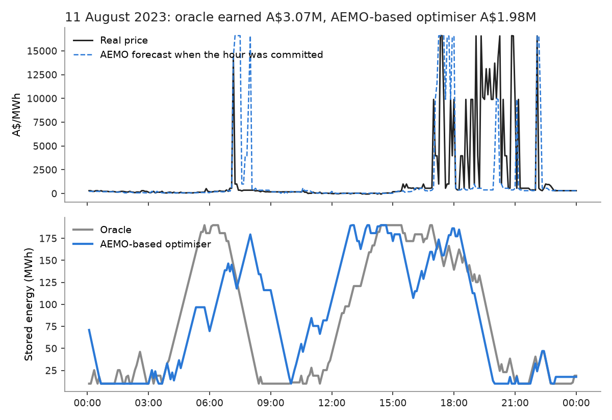

# How much battery arbitrage survives forecast error?

A battery with perfect foresight of electricity prices could schedule its charging and discharging to maximise the value of energy arbitrage. In practice, however, batteries must make dispatch decisions under uncertainty, relying on imperfect forecasts of future electricity prices.

This project investigates how forecast quality and dispatch strategy affect the proportion of theoretical arbitrage value that can be captured in practice. In particular, it seeks to distinguish the value of better price forecasts from the value of better optimisation.

The case study considers a hypothetical 100 MW / 200 MWh battery with 85% round-trip efficiency, located at Hornsdale in South Australia and participating in the National Electricity Market (NEM) from June 2023 to May 2024. While the battery is hypothetical, the historical electricity prices and forecasts published by the Australian Energy Market Operator (AEMO) are real.

The principal finding is that **optimising against AEMO's published price forecasts captures approximately half of the perfect-foresight arbitrage value**, with much of its advantage over a naive forecast coming from a handful of extreme price events.

## Results

Four strategies are compared against a perfect-foresight ceiling to isolate the effects of limited planning horizons, forecast quality, and dispatch methodology.

The perfect-foresight ceiling optimises dispatch over the entire study year with complete knowledge of future prices. The remaining strategies operate on a rolling 24-hour planning horizon, updating their dispatch decisions hourly.

The rolling-horizon optimiser supplied with realised future prices is referred to as the *oracle*. Although this strategy is not implementable in practice, it provides a benchmark against which the cost of forecast uncertainty can be measured separately from the cost of rolling-horizon decision-making.

| Strategy | Net arbitrage revenue | Share of ceiling |
| --- | ---: | ---: |
| Full-year perfect-foresight ceiling | A\$26.35M | 100% |
| Rolling-horizon optimiser with perfect foresight (oracle) | A\$26.35M | 99.98% |
| Rolling-horizon optimiser with AEMO forecasts | A\$13.44M | 51.0% |
| Rolling-horizon optimiser with a 7-day price profile | A\$8.36M | 31.7% |
| Rule-based strategy with AEMO forecasts | A\$7.56M | 28.7% |


### The cost of forecast uncertainty

Restricting the optimisation to a rolling 24-hour planning horizon has a negligible effect on annual arbitrage revenue when future prices are known.

The oracle finishes within A\$4,600 of the full-year perfect-foresight ceiling, despite committing dispatch decisions only one hour at a time. By contrast, replacing perfect foresight with AEMO's published forecasts reduces annual revenue by approximately A\$12.91 million.

Forecast uncertainty therefore accounts for almost the entire gap between the theoretical ceiling and the AEMO-based optimiser.

### The value of forecasting and optimisation

The experimental design allows two separate sources of economic value to be identified.

- **Forecast quality.** Optimising against AEMO's forecasts generates approximately A\$5.08 million more than optimising against a naive historical price profile, which predicts each five-minute price using the median price at the corresponding time of day over the preceding seven days.
- **Dispatch optimisation.** Given identical AEMO forecasts, the optimisation-based strategy generates approximately A\$5.88 million more than a simple rule-based charging and discharging strategy.

These results demonstrate that both the quality of the information available to a battery and the methodology used to translate that information into dispatch decisions have substantial economic consequences.

### Statistical robustness

To assess whether the observed performance differences are driven by a small number of exceptional trading days, paired daily revenue differences are evaluated using a block bootstrap.

| Daily revenue difference | Mean | 95% confidence interval |
| --- | ---: | ---: |
| Oracle minus AEMO optimiser | A\$35,300 | A\$28,500 to A\$44,900 |
| AEMO optimiser minus historical-profile optimiser | A\$13,900 | A\$3,000 to A\$28,200 |
| AEMO optimiser minus AEMO rule-based strategy | A\$16,100 | A\$6,700 to A\$29,600 |

All three confidence intervals exclude zero, providing statistical evidence of positive mean daily revenue differences.

However, the economic value of AEMO's forecasts is highly concentrated. The AEMO-based optimiser outperforms the historical-profile optimiser on only 57% of trading days, with a median daily advantage of approximately A\$1,800.

Approximately 97% of its annual revenue advantage is generated during the 15 days on which electricity prices exceed A\$5,000/MWh.

This suggests that the economic value of a forecasting model for battery arbitrage depends heavily on its ability to anticipate extreme price events, rather than consistently outperforming alternative forecasts during ordinary market conditions.

### Understanding the cost of forecast error

The revenue lost through forecast uncertainty is less concentrated. The 15 extreme-price days account for 19% of the annual revenue gap between the AEMO-based optimiser and the oracle, the single worst-performing day for approximately 8%, and the ten worst-performing days for just over a fifth. Most of the gap accumulates on ordinary days.



The figure examines the largest daily revenue shortfall, which occurred on 11 August 2023. The upper panel compares realised electricity prices with the AEMO forecasts available when each hourly dispatch decision was made. The lower panel illustrates the resulting state-of-charge trajectories.

Two distinct forecasting failures can be observed.

**Overprediction of price spikes.** Following a realised price spike at 07:10, AEMO continued to forecast prices of up to A\$16,600/MWh until 08:00. In anticipation of these spikes, the battery charged at A\$352/MWh. The forecast spikes did not materialise, leaving the battery having acquired energy at an unnecessarily high price.

**Underprediction of price spikes.** From 18:35, prices spiked on and off until 21:00, but AEMO forecast only A\$380/MWh to A\$1,000/MWh for every interval up to 19:55. Valuing its stored energy accordingly, the AEMO-based optimiser discharged at full power whenever the price rose above that level, including at A\$556/MWh between spikes, and had exhausted its usable capacity by 20:00. The oracle sold only into the spikes, recharging between them, and still held more than 100 MWh at 19:30, which it sold into the spikes that followed.

These examples illustrate the intertemporal nature of battery arbitrage. Forecast errors affect not only immediate trading decisions but also the availability of stored energy for subsequent opportunities. An incorrect forecast can therefore generate losses that persist beyond the interval in which the error occurs.

The AEMO-based optimiser also cycled the battery more than the oracle, completing 817 equivalent full cycles over the study year compared with 728, while earning approximately half the net arbitrage revenue.

## Methodology

### Battery specification

The battery is modelled using the following physical and economic parameters.

| Parameter | Value |
| --- | --- |
| Maximum charging power | 100 MW |
| Maximum discharging power | 100 MW |
| Nominal energy capacity | 200 MWh |
| Usable energy capacity | 180 MWh |
| Round-trip efficiency | 85% |
| Minimum state of charge | 5% |
| Maximum state of charge | 95% |
| Degradation cost | A\$25/MWh discharged |
| Connection point | Hornsdale, South Australia |
| Settlement resolution | 5 minutes |
| Dispatch decision frequency | Hourly |
| Optimisation horizon | 24 hours |
| Study period | June 2023 – May 2024 |

The battery begins the study at its minimum state of charge, and any energy remaining at the end of the study period is assigned zero terminal value.

Equivalent full cycles are calculated relative to the nominal energy capacity of 200 MWh.

### Rolling-horizon optimisation

The optimisation-based strategies use a rolling-horizon framework, similar to model predictive control (MPC).

At the beginning of each hour, the optimiser:

1. Constructs a forecast of electricity prices at five-minute resolution over the following 24 hours.
2. Optimises charging and discharging decisions over the forecast horizon, subject to the battery's physical and economic constraints.
3. Derives price thresholds for charging and discharging over the first hour of the optimised schedule.
4. Executes dispatch against realised five-minute prices using these thresholds.
5. Updates the battery's state of charge and repeats the optimisation at the beginning of the following hour.

The dispatch schedule is obtained by solving a mixed-integer linear program (MILP) using HiGHS, formulated so that the battery cannot charge and discharge within the same settlement interval. Binary variables are only needed at deeply negative prices, where doing both at once would otherwise be profitable; elsewhere a continuous relaxation gives the same schedule.

Rather than committing to a fixed physical dispatch schedule for the following hour, the strategy uses the optimisation to determine the economic value of stored energy. This establishes a maximum willingness to pay for charging and a minimum acceptable price for discharging.

During the committed hour, the battery charges or discharges at full power when the realised price is past the corresponding threshold, runs the planned amount when the price is exactly at the threshold, and otherwise remains idle, subject to its state-of-charge constraints.

This approach allows dispatch to respond to unexpected price movements without reoptimising the strategy using information that was unavailable at the time of commitment. When forecast prices equal realised prices, the threshold-based dispatch reproduces the optimised schedule.

### Price forecasts

Three forecasting approaches are considered.

| Forecast | Description |
| --- | --- |
| Perfect foresight | Realised future five-minute electricity prices, used exclusively as a benchmark. |
| Historical profile | Median electricity price for each five-minute time-of-day interval over the preceding seven days. |
| AEMO forecasts | A composite forecast combining AEMO's published pre-dispatch forecasts with the historical price profile. |

The composite AEMO forecast is constructed according to the forecast horizon.

| Forecast horizon | Source |
| --- | --- |
| 0–1 hour | Latest available five-minute pre-dispatch forecast (P5MIN) |
| 1–4 hours | Latest available half-hourly pre-dispatch forecast |
| 4–24 hours | Seven-day historical price profile |

The four-hour cut-off was selected using observations from months preceding the study period. Over longer forecast horizons, pre-dispatch tended to overpredict extreme price events and performed worse than the historical-profile baseline under the preliminary evaluation.

The cut-off was fixed before the study year was run, so the reported results are out of sample with respect to this choice. The preliminary evaluation itself is not included in this repository. The cut-off is a single parameter, `predispatch_hours` in `battery/forecasts.py`, so its effect on the study year can be explored by changing it and rerunning `run.py`. Any cut-off chosen that way would, however, be tuned on the study year itself.

Forecasts are included only after their publication time, ensuring that dispatch decisions do not use information that would have been unavailable to a market participant at the time.

### Rule-based dispatch

A simpler rule-based strategy is included to distinguish the value of mathematical optimisation from the value of the underlying price forecasts.

The strategy identifies the two cheapest and two most expensive forecast hours within the next 24 hours, scheduling charging and discharging accordingly.

Trading occurs only where the anticipated price spread is sufficient to cover round-trip efficiency losses and modelled degradation costs.

Both the rule-based strategy and the AEMO-based optimiser receive the same price forecasts, allowing their performance difference to be attributed to differences in dispatch methodology.

### Revenue and settlement

All strategies are evaluated against realised five-minute electricity prices, irrespective of the forecasts used to determine dispatch.

Energy settlement is adjusted using the applicable marginal loss factors for Hornsdale. A throughput-based degradation cost of A\$25 is deducted for each MWh discharged.

Reported net arbitrage revenue therefore incorporates:

- Revenue from discharging energy into the market.
- The cost of purchasing energy from the market.
- Round-trip efficiency losses.
- Marginal loss factor adjustments.
- Modelled battery degradation costs.

Capital expenditure, fixed operating costs, and revenue from other electricity market services are excluded. Net arbitrage revenue should therefore not be interpreted as total battery profitability.

### Perfect-foresight ceiling

The theoretical revenue ceiling is calculated by solving a single linear program over the entire study year using realised electricity prices.

Unlike the rolling-horizon strategies, this optimisation has complete knowledge of future prices and is not restricted to a 24-hour planning horizon.

The resulting objective value provides an upper bound on the revenue attainable by the modelled strategies. Expressing each strategy's revenue as a proportion of this ceiling provides a common basis for evaluating arbitrage value capture.

### Statistical analysis

Statistical uncertainty in the mean daily revenue differences is estimated using a paired block bootstrap with seven-day blocks.

Resampling consecutive blocks rather than individual trading days preserves short-term temporal dependence arising from persistent market conditions and the battery's ability to carry stored energy between days.

## Limitations

The study deliberately simplifies several aspects of commercial battery operation to isolate the relationship between price forecasts, dispatch optimisation, and arbitrage revenue.

- **Energy-only participation.** The analysis excludes frequency control ancillary services (FCAS) and other potential revenue streams. These can materially affect the economics and optimal dispatch of a commercial battery.

- **Price-taking assumption.** The battery's dispatch is assumed to have no effect on electricity prices. In practice, a 100 MW battery may materially influence market outcomes, particularly during periods of supply scarcity.

- **Hourly decision frequency.** Dispatch strategies are updated hourly, whereas NEM participants can rebid at five-minute resolution. More frequent optimisation could allow a battery to respond more effectively to changing market conditions.

- **Simplified bidding framework.** The model allows charging and discharging price thresholds to be updated freely each hour. In practice, NEM participants operate within submitted bid price bands and associated rebidding constraints. The flexibility of the modelled dispatch framework may therefore overstate the revenue achievable by forecast-based strategies.

- **Intra-hour price response.** Within each committed hour, the battery responds to every realised five-minute price, running at full power whenever the price crosses a threshold. A real bid stack can respond only at the band prices it submitted, so this further flatters the forecast-based strategies. The oracle is unaffected, because its thresholds are derived from the realised prices.

- **Simplified degradation model.** Battery degradation is represented by a constant cost per MWh discharged rather than an electrochemical model accounting for factors such as depth of discharge, temperature, and calendar ageing.

- **Limited geographical and temporal scope.** The study examines a single connection point in South Australia over one year. The results may not generalise to other NEM regions, battery specifications, or market conditions.

The reported revenues should consequently be interpreted as comparative estimates rather than directly achievable commercial trading outcomes.

## Running the project

The project uses `uv` for dependency management.

```sh
uv sync
uv run pytest
uv run python run.py
```

The repository includes the processed AEMO prices and forecasts the study reads (about 22 MB in `data/cache/partitions/`, one file per source table and month), so the results reproduce without downloading anything. The full-year simulation takes about a minute and a half, and the generated tables and figures are written to `results/`.

If the study dates are changed, any months missing from the cache are downloaded from AEMO on the next run, roughly 1 GB for a full year. Downloads are retried following network errors, and files are written atomically so that an interrupted run can simply be restarted.

Market price caps and marginal loss factors are defined by financial year in `battery/data.py`. Extending the study beyond the 2022–23 and 2023–24 financial years requires the corresponding parameters to be added before execution. The program raises an error if the required parameters are unavailable.

### Repository structure

```text
battery/
    data.py        Historical data retrieval and caching
    forecasts.py   Perfect-foresight, historical, and AEMO forecasts
    model.py       Battery model and mathematical optimisation
    policies.py    Rolling-horizon and rule-based dispatch
    study.py       Simulation, settlement, and statistical analysis
    plots.py       Results visualisation

tests/             Unit and integration tests
results/           Generated tables and figures
data/cache/        Processed AEMO prices and forecasts for the study period
data/trace.parquet Dispatch trace for the figures (written by run.py)
run.py             Main study entry point
```

The test suite includes analytically verifiable dispatch cases, checks for look-ahead bias, verification of the perfect-foresight upper bound, forecast construction, negative-price handling, revenue settlement, and AEMO data ingestion.

### Data

Electricity prices and pre-dispatch forecasts are sourced from the Australian Energy Market Operator's NEMweb archive. Market data © AEMO, used in accordance with AEMO's copyright permissions.

## Conclusion

Both forecast quality and dispatch optimisation contribute substantially to economic performance. However, the value of improved forecasting is disproportionately concentrated around a small number of extreme price events, during which errors in the anticipated timing and magnitude of price spikes can have significant consequences for subsequent dispatch decisions.

These findings motivate evaluating electricity price forecasts not only through conventional statistical accuracy measures but also through the economic outcomes of the decisions they inform.
