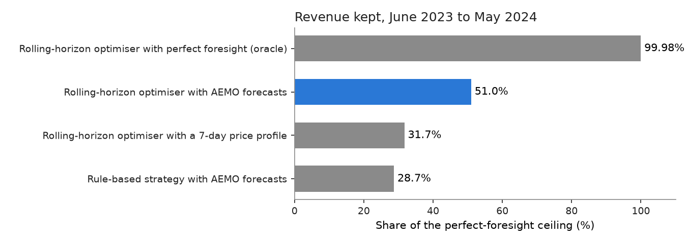

# How much battery arbitrage survives forecast error?

[](https://github.com/joshcc27/nem-battery-forecasts/actions/workflows/tests.yml)

A battery that knew every future electricity price could charge at the cheapest times and
sell at the dearest. A real battery has to decide from forecasts. I wanted to know how much
of the perfect-foresight revenue survives that, and how much of what's lost comes down to
the forecast rather than the way decisions are made.

The test case is a hypothetical 100 MW / 200 MWh battery with 85% round-trip efficiency,
connected at Hornsdale in South Australia and trading in the National Electricity Market
(NEM) from June 2023 to May 2024. The battery is made up, but the prices and the forecasts
published by the Australian Energy Market Operator (AEMO) are real.

**Optimising against AEMO's published forecasts captures about half of the
perfect-foresight revenue**, A\$13.4 million of A\$26.4 million. AEMO's forecasts beat a
naive forecast mainly on a handful of extreme price days, but most of the revenue lost
against perfect foresight is lost on ordinary days.

## Results

I compared four strategies against a perfect-foresight ceiling. The ceiling plans the whole
year at once with every price known. The four strategies each re-plan every hour over the
next 24 hours.

One of them, the *oracle*, is fed the real future prices. Nobody could run it in practice,
but it separates the cost of forecast error from the cost of only planning a day ahead.

| Strategy | Net arbitrage revenue | Share of ceiling |
| --- | ---: | ---: |
| Full-year perfect-foresight ceiling | A\$26.35M | 100% |
| Rolling-horizon optimiser with perfect foresight (oracle) | A\$26.35M | 99.98% |
| Rolling-horizon optimiser with AEMO forecasts | A\$13.44M | 51.0% |
| Rolling-horizon optimiser with a 7-day price profile | A\$8.36M | 31.7% |
| Rule-based strategy with AEMO forecasts | A\$7.56M | 28.7% |



### With hourly bids, nearly all the loss is forecast error

Planning a day ahead and committing one hour at a time costs almost nothing. With the real
prices, the oracle finishes within A\$4,600 of the ceiling over the whole year. Switching
to AEMO's forecasts costs A\$12.91 million. So forecast error accounts for almost the
entire gap.

That depends on the battery being free to reset its price limits every hour. In the NEM,
the ten price bands a battery offers in each direction are fixed for each trading day at
12:30 the day before, and rebids on the day can only move quantity between them. Under that
rule, part of the gap would come from bidding as well as from forecast error.

### What the forecast and the optimiser are each worth

- **Forecast quality.** Optimising against AEMO's forecasts earns A\$5.08 million more than
  optimising against a naive profile. The profile predicts each five-minute price as the
  median price at that time of day over the previous seven days.
- **Decision method.** With the same AEMO forecasts, the optimiser earns A\$5.88 million
  more than a simple charge-cheap, sell-dear rule.

### Checking the gaps aren't down to a few days

I compared the strategies day by day and put 95% confidence intervals on the mean daily
difference with a block bootstrap. All three intervals stay above zero.

| Daily revenue difference | Mean | 95% confidence interval |
| --- | ---: | ---: |
| Oracle minus AEMO optimiser | A\$35,300 | A\$28,500 to A\$44,900 |
| AEMO optimiser minus historical-profile optimiser | A\$13,900 | A\$3,000 to A\$28,200 |
| AEMO optimiser minus AEMO rule-based strategy | A\$16,100 | A\$6,700 to A\$29,600 |

AEMO's advantage over the profile is very uneven, though. It wins on only 57% of days, and
on the median day by about A\$1,850. About 97% of its advantage over the year comes from
the 15 days when prices went above A\$5,000/MWh. For this battery, AEMO's forecasts were
worth having almost entirely for how they did on those days, which argues for judging
price forecasts by the revenue they lead to as well as by their accuracy.

### Where the revenue is lost

The loss against the oracle is spread more evenly. The 15 extreme-price days account for
19% of it, the single worst day for about 8%, and the worst ten days for just over a fifth.
Most of the gap builds up on ordinary days. `results/extremes.csv` has the extreme-day
figures quoted above.


The figure shows the worst day, 11 August 2023. The top panel compares the real price with
the AEMO forecast the battery was using when it committed each hour. The bottom panel shows
how much energy each battery held. The forecast was wrong in both directions that day.

In the morning, after a real spike at 07:10, AEMO kept forecasting prices of up to
A\$16,600/MWh until 08:00. The battery charged at A\$352/MWh to be ready for spikes that
never arrived.

In the evening the reverse happened. From 18:35, prices spiked on and off until 21:00, but
AEMO forecast only A\$380 to A\$1,000/MWh for every interval up to 19:55. Valuing its
stored energy accordingly, the AEMO-based battery sold at full power whenever the price
beat that level, including at A\$556/MWh between spikes, and was empty by 20:00. The
oracle sold only into the spikes, recharged between them, and still held over 100 MWh at
19:30 to sell into the spikes that followed. The AEMO-based battery had nothing left for
them.

Over the year the AEMO-based battery also cycled more than the oracle, 817 full cycles
against 728, while earning about half as much.

## Method

### Battery

| Parameter | Value |
| --- | --- |
| Maximum charging and discharging power | 100 MW |
| Nominal energy capacity | 200 MWh |
| Usable energy capacity | 180 MWh (5% to 95% charge) |
| Round-trip efficiency | 85% |
| Degradation cost | A\$25/MWh discharged |
| Connection point | Hornsdale, South Australia |
| Settlement | 5-minute prices |
| Decisions | Hourly, planning 24 hours ahead |
| Study period | June 2023 to May 2024 |

The battery starts at its 5% floor, and any energy left at the end of the year is worth
nothing. Full cycles are counted against the nominal 200 MWh.

### Hourly planning

At the start of each hour, each optimising strategy:

1. forecasts the next 24 hours of five-minute prices
2. plans charging and discharging over those 24 hours
3. turns the first hour of the plan into price limits for charging and discharging
4. trades against the real five-minute prices using those limits
5. updates the battery's charge and repeats an hour later

The plan is a mixed-integer program solved with HiGHS, set up so the battery can't charge
and discharge in the same interval. Binary variables are only needed at deeply negative
prices, where doing both at once would otherwise pay. Everywhere else the continuous
version gives the same plan.

The battery doesn't follow the plan blindly. The plan puts a value on stored energy, which
sets the most the battery will pay to charge and the least it will accept to discharge.
When the real price is past one of those limits, the battery runs at full power. When it's
exactly at the limit, it runs the planned amount. Otherwise it waits. If the forecast was
right, this reproduces the plan exactly.

### Forecasts

| Forecast | Description |
| --- | --- |
| Perfect foresight | The real future prices. Only used as a benchmark. |
| Historical profile | The median price at each five-minute time of day over the previous seven days. |
| AEMO | AEMO's published forecasts, filled in with the historical profile further ahead. |

The AEMO forecast is stitched together by horizon:

| Horizon | Source |
| --- | --- |
| 0 to 1 hour | Latest five-minute pre-dispatch forecast (P5MIN) |
| 1 to 4 hours | Latest half-hourly pre-dispatch forecast |
| 4 to 24 hours | Seven-day historical profile |

I stopped using pre-dispatch at four hours because further ahead it over-forecasts spikes.
In the months I checked before the study period, it did worse than the profile beyond four
hours.

The cut-off was fixed before the study year was run, so the results are out of sample with
respect to this choice. That preliminary check isn't included in this repository. The
cut-off is one parameter, `predispatch_hours` in `battery/forecasts.py`, so you can change
it and rerun `run.py` to see its effect. A cut-off chosen that way would be tuned on the
study year itself, though.

Each forecast is only used from the time AEMO published it, so no strategy ever sees a
forecast it couldn't have had.

### Rule-based strategy

The rule charges in the two cheapest forecast hours of the next 24 and discharges in the two
dearest, but only if the price spread covers efficiency losses and degradation. It uses the
same AEMO forecasts as the optimiser, so the difference between them is down to how
decisions are made.

### Revenue

Every strategy is settled at the real five-minute prices, adjusted by Hornsdale's marginal
loss factors, less A\$25 for each MWh discharged to cover degradation. Efficiency losses
are included. Capital costs, fixed operating costs and revenue from other market services
are not, so these figures aren't a measure of total profitability.

### Ceiling

The ceiling solves the whole year as one linear program with every price known. No
strategy can beat it, so each strategy's revenue is reported as a share of it.

### Confidence intervals

The intervals come from a paired bootstrap that resamples week-long blocks of days.
Keeping consecutive days together matters because market conditions persist and the
battery carries energy from one day into the next.

## Limitations

- **Energy market only.** Frequency control services (FCAS) are a large part of what South
  Australian batteries earn, and they aren't included.
- **Price taker.** A real 100 MW battery would move the price, especially during spikes.
- **Hourly decisions.** NEM participants can rebid every five minutes.
- **Simplified bidding.** The price limits can change freely every hour. Real band prices
  are fixed the day before, which costs every strategy revenue, the oracle included (see
  [above](#with-hourly-bids-nearly-all-the-loss-is-forecast-error)).
- **Reacting within the hour.** Within each hour the battery responds to every real
  five-minute price, running at full power whenever the price crosses a limit. A real bid
  stack can only respond at the band prices it submitted, so this flatters the
  forecast-based strategies further. The oracle isn't affected, because its limits come
  from the real prices.
- **Simple degradation.** Degradation is a flat cost per MWh discharged, with no effect of
  depth of discharge, temperature or calendar ageing.
- **One site, one year.** The results may not carry over to other regions, batteries or
  years.

Treat the revenues as comparisons between strategies rather than as what a real battery
would have earned.

## Running it

You'll need [uv](https://docs.astral.sh/uv/).

```sh
uv sync
uv run pytest
uv run python run.py
```

The repository includes the processed AEMO prices and forecasts the study uses (about 22 MB
in `data/cache/partitions/`, one file per table and month), so nothing needs downloading.
The full year runs in about a minute and a half and writes its tables and figures to
`results/`.

If you change the study dates, any missing months are downloaded from AEMO on the next run,
roughly 1 GB for a full year. Downloads retry after network errors, and files are written
whole or not at all, so an interrupted run can just be restarted.

Price caps and marginal loss factors are set by financial year in `battery/data.py`. To run
outside 2022-23 and 2023-24, add those years first. The program stops with an error if
they're missing.

```text
battery/
    data.py        downloads and caches prices and AEMO forecasts
    forecasts.py   perfect-foresight, historical and AEMO forecasts
    model.py       the battery model and the optimisation
    policies.py    hourly rolling dispatch and the rule
    study.py       runs the year, settles revenue, compares strategies
    plots.py       draws the figures

tests/             hand-worked cases, look-ahead checks, the ceiling bound, forecast
                   stitching, negative prices, settlement and data loading
results/           tables and figures
data/cache/        processed AEMO prices and forecasts for the study period
data/trace.parquet dispatch trace used by the figures (written by run.py)
run.py             runs the study and draws the figures
```

## Data

Prices and pre-dispatch forecasts come from AEMO's NEMweb archive. Market data © AEMO, used
in accordance with AEMO's copyright permissions.
